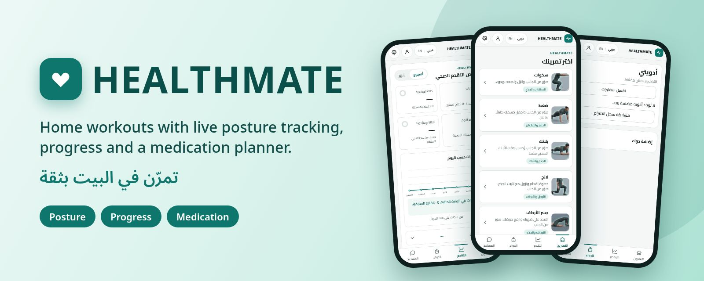

<p align="center"></p>

# HEALTHMATE

**Home workouts with real-time form guidance from your phone camera. Private by default, bilingual (Arabic RTL / English LTR), installable as a PWA.**

[](https://github.com/steven556-maker/HEALTHMATE/actions/workflows/ci.yml)
[](https://github.com/steven556-maker/HEALTHMATE/actions/workflows/deploy.yml)


[English](#overview) | [العربية](#النسخة-العربية)

</div>

---

## Table of contents

- [Overview](#overview)
- [Features](#features)
- [Usage notes](#usage-notes)
- [Technology stack](#technology-stack)
- [Architecture](#architecture)
- [Getting started](#getting-started)
- [Available scripts](#available-scripts)
- [Project structure](#project-structure)
- [Configuration](#configuration)
- [Deployment](#deployment)
- [Privacy and security](#privacy-and-security)
- [Testing](#testing-and-quality-checks)
- [Known limitations](#known-limitations)
- [Roadmap](#roadmap)
- [Contributing](#contributing)
- [License](#license)
- [النسخة العربية](#النسخة-العربية)

---

## Overview

HEALTHMATE helps users follow guided home workouts and monitor their activity. Exercise-pose analysis runs in the browser, while user records are stored locally by default. Optional account and cloud-sync features are available when configured and enabled by the user.

## Features

- **Camera-guided workouts:** 7 supported exercises — squat, push-up, plank, lunge, glute bridge, wall sit, and sit-to-stand (30-second chair-stand test).
- **Live exercise feedback:** repetition counting or hold timers, with form checks and plain-language corrections.
- **Audio coaching:** 20 bundled recorded Arabic cues (MP3), device speech synthesis for English, and a fallback when an audio file is unavailable. A shared queue prevents overlapping prompts; a global mute control is provided.
- **Progress tracking:** weekly activity dashboard and sleep, stress, and mood check-ins.
- **Rules-based coaching:** suggestions include the reason behind each recommendation.
- **Medication organiser:** local-only stock and adherence tracking. It does not recommend medication or doses.
- **Arabic and English:** right-to-left Arabic and left-to-right English layouts, with matching translation keys checked by a test.
- **Installable PWA:** offline-capable generated service worker, light and dark themes, and optional Web Push reminders.
- **Optional cloud account and sync:** Supabase Auth and Postgres with Row Level Security, explicit consent before upload, and per-item merging across devices (a `version` column prevents silent overwrites).
- **Optional AI assistant:** Cloudflare Worker proxy with Gemini model failover, then Groq, then a static FAQ fallback. Requires sign-in. Serious-symptom messages direct users toward urgent care.

---

## Usage notes

The app is designed for mobile and switches language and text direction (Arabic RTL / English LTR). For the most reliable pose tracking, film exercises from a side-on angle with the full movement visible.

---

## Technology stack

| Area | Technology |
| --- | --- |
| Application | TypeScript 5.7, Vite 6, vanilla TS core with React 19 islands, Tailwind CSS 4, lucide-react |
| Pose estimation | MediaPipe Tasks Vision 0.10.14 |
| PWA | vite-plugin-pwa |
| Local storage | Browser `localStorage` |
| Optional backend | Supabase Auth, Postgres, Row Level Security |
| Optional server functions | Cloudflare Workers and KV |
| Optional AI assistant | Gemini, Groq, static fallback |
| Quality checks | ESLint 9, `node --test` with `tsx`, Playwright |
| CI/CD | GitHub Actions, GitHub Pages |

## Architecture

```text
Browser
  ├─ Vite + TypeScript application, with isolated React UI islands
  ├─ MediaPipe Pose Landmarker
  │    └─ Joint angles, repetition counting, and exercise-form rules
  ├─ localStorage (default local-first data store)
  ├─ Supabase (optional)
  │    └─ Authentication and user data protected by RLS
  └─ Cloudflare Worker (optional)
       ├─ POST /api/chat
       ├─ GET /api/health and /push/*
       ├─ Supabase-token verification, KV quota, and rate limiting
       └─ Gemini model failover → Groq → static fallback

Deployment: GitHub Pages at /HEALTHMATE/
```

### Architecture notes

- `src/` is the source of truth. `vite build` generates `dist/`.
- TypeScript checking uses `tsc --noEmit`; it does not emit build files.
- The core camera and exercise pipeline is implemented in vanilla TypeScript. React is used for isolated UI areas such as charts, navigation, and the progress dashboard.
- The service worker is generated by `vite-plugin-pwa` and loads `web/notify-sw.js`.
- Cross-device sync merges records by `id`, `updatedAt`, and tombstones in `src/core/merge.ts`.
- Sync is merge-based, not overwrite: records merge by `id`, `updatedAt` and tombstones, and the database uses a `version` column for compare-and-set.
- Assistant resilience: quota errors (429/404) skip to the next model instantly; transient errors (5xx, timeout, network) retry in up to 3 rounds; the UI retries silently before showing a built-in reply.
- MediaPipe assets are self-hosted in `web/vendor`. If they are unavailable, the application falls back to the matching CDN version (0.10.14).

---

## Getting started

### Requirements

- Node.js 22 (the version used in CI) and npm
- A browser with camera access

Camera access requires `localhost` during development or HTTPS when deployed.

### Install dependencies

```bash
git clone https://github.com/steven556-maker/HEALTHMATE.git
cd HEALTHMATE
npm ci
```

### Start the development server

```bash
npm run dev
```

The application runs locally without environment variables. Account and assistant features display as not configured until their corresponding services are set up.

### Build and preview

The production build uses the `/HEALTHMATE/` base path.

```bash
npm run build
npm run preview
```

The preview server is expected at:

```text
http://localhost:4173/HEALTHMATE/
```

---

## Available scripts

| Command | Description |
| --- | --- |
| `npm run dev` | Start the Vite development server (runs the vendor preparation step first) |
| `npm run serve` | Run the local serving script |
| `npm run build` | Type-check and build the application into `dist/` |
| `npm run preview` | Preview the production build |
| `npm run typecheck` | Run TypeScript checking with `tsc --noEmit` |
| `npm run lint` | Run ESLint |
| `npm test` | Run unit and integration tests |
| `npm run test:e2e` | Run Playwright end-to-end tests (`test:e2e:headed` for a visible browser) |
| `npm run vendor` | Copy MediaPipe WASM files to `web/vendor` and fetch the model |
| `npm run check:env` | Validate environment configuration before a cloud-enabled build |
| `npm run dev:worker` | Run the Cloudflare Worker locally on port 8787 |

---

## Project structure

```text
.
├── src/
│   ├── core/          pure logic: angles, exercises, rep counter, form rules, coach,
│   │                  analytics, merge/sync, medications, backup
│   ├── app/           UI modules, storage, audio, i18n, assistant, cloud sync, push
│   ├── components/ui/ React islands (progress dashboard, sign-in)
│   ├── locales/       ar.json, en.json
│   └── styles/
├── web/               static assets: audio cues, images, icons, manifest, notify-sw.js, styles
├── worker/            assistant Worker (chat, model chain, retry, fallback, push)
├── supabase/          schema.sql (table, RLS, version column, delete_my_account())
├── scripts/           vendor-mediapipe, check-build-env, gen-vapid
├── tests/             unit/integration tests and tests/e2e
├── docs/              verification, preview deployment, feasibility notes
└── .github/workflows/ ci.yml, deploy.yml, preview.yml
```

## Configuration

Cloud features are optional. To configure them, copy `.env.example` to `.env` and provide the relevant values.

| Variable | Used in | Purpose |
| --- | --- | --- |
| `VITE_SUPABASE_URL` | Build/client | Supabase project URL |
| `VITE_SUPABASE_ANON_KEY` | Build/client | Supabase publishable/anonymous key; access must be protected by RLS |
| `VITE_ASSISTANT_URL` | Build/client | Deployed assistant Worker URL |
| `VITE_PUSH_PUBLIC_KEY` | Build/client | Optional Web Push public key |
| `VITE_GOOGLE_AUTH` | Build/client | Set to `true` to show Google sign-in |

### Worker secrets and variables

| Name | Purpose |
| --- | --- |
| `GEMINI_API_KEY` | Primary AI provider (secret) |
| `GROQ_API_KEY` | Optional second provider (secret) |
| `SUPABASE_URL`, `SUPABASE_ANON_KEY` | Used to verify user tokens |
| `ALLOWED_ORIGIN` | Allowed browser origins (CORS) |
| `GEMINI_MODELS` | Ordered model chain |
| `RATE_KV` | KV namespace for the per-user daily quota |
| `VAPID_PRIVATE_JWK` | Optional Web Push private key |

### Server-side secrets

Configure provider secrets on the Worker using Wrangler, for example:

```bash
wrangler secret put GEMINI_API_KEY
```

For local Worker development, copy `worker/.dev.vars.example` to `worker/.dev.vars`, then run `npm run dev:worker` (port 8787) next to `npm run dev`.

**Never** place provider API keys or a Supabase `service_role` key in client-side code or in `VITE_` variables. Do not commit real secrets to the repository.

---

## Optional Supabase setup

1. Create a Supabase project.
2. Run `supabase/schema.sql` in the Supabase SQL Editor.
3. Set `VITE_SUPABASE_URL` and `VITE_SUPABASE_ANON_KEY` in your environment.
4. Under Authentication > URL Configuration, set the Site URL to your deployed URL and add it to Redirect URLs, then run `npm run check:env`.

Full steps, including Google sign-in: [`docs/verify-cloud-and-assistant.md`](docs/verify-cloud-and-assistant.md).

Cloud sync is not enabled merely by adding configuration: users must sign in and provide consent before their data is uploaded.

---

## Deployment

### GitHub Pages

- The workflow at `.github/workflows/deploy.yml` publishes `dist/` when changes are pushed to `main`.
- Configure the GitHub Actions secrets `VITE_SUPABASE_URL` and `VITE_SUPABASE_ANON_KEY` when using Supabase.
- Configure the Actions variable `VITE_ASSISTANT_URL` when using the assistant.
- Keep the repository name `HEALTHMATE`, because the published site uses the `/HEALTHMATE/` base path.

### Optional Cloudflare Worker

1. Create a KV namespace named `RATE_KV`.
2. Configure the required Cloudflare and provider secrets.
3. Deploy manually, or through CI as described below:

```bash
npx wrangler deploy --config worker/wrangler.toml
```

To deploy the Worker through CI, set the variables `RATE_KV_NAMESPACE_ID`, `CLOUDFLARE_ACCOUNT_ID` and `DEPLOY_WORKER=true`, and the secrets `CLOUDFLARE_API_TOKEN` and `GEMINI_API_KEY`. After the first deploy, set `VITE_ASSISTANT_URL` to the Worker URL and rebuild Pages. Pull request previews are described in [`docs/preview-deployment.md`](docs/preview-deployment.md).

For deployment checks and verification steps, see [`docs/verify-cloud-and-assistant.md`](docs/verify-cloud-and-assistant.md).

---

## Privacy and security

- **Camera processing:** pose analysis runs in the browser. Camera frames and video are not uploaded or stored by the pose-analysis feature.
- **Default storage:** records are stored in browser `localStorage` by default.
- **Optional cloud sync:** data is sent to Supabase only after the user signs in and consents to sync.
- **Excluded from sync:** chat history and camera data are not synced.
- **Assistant context:** the assistant receives only recent chat messages (the last 20, up to 2000 characters each). A separate consent switch is required before it receives a limited numeric summary (sessions in the last 7 days and today's sleep, stress, and mood). Body weight is not sent.
- **Third-party requests:** depending on enabled features and asset availability, the app may contact Supabase, the assistant Worker, Google Fonts, and the MediaPipe CDN fallback.
- **Worker protection:** the Worker requires a valid signed-in user and applies per-IP and per-user daily limits.
- **Database:** Row Level Security applies to every operation, `anon` has no access, and rows are capped at 2 MB.
- **Account deletion:** the in-app “delete my account and data” action removes cloud data. Signing out alone does not delete it.

Review the deployed configuration and privacy notices before using the application with real user data.

---

## Testing and quality checks

Run the main checks with:

```bash
npm run typecheck
npm run lint
npm test
```

Unit and integration tests cover angle math, rep counting, exercise rules, the coach, analytics, merge and sync, medications, the assistant model chain and retry logic, the Worker, audio coordination, push, and locale key parity.

Run browser end-to-end tests with:

```bash
npx playwright install chromium
npm run test:e2e
```

End-to-end tests target the deployed site by default. Set `HEALTHMATE_BASE_URL` to test a different URL.

---

## Known limitations

- Web Push medication reminders are implemented in the Worker but are disabled in the default GitHub Pages build; they require VAPID keys.
- Bundled recorded voice cues are Arabic only. Other cases use the device's speech synthesis. Some devices may not provide an Arabic voice, in which case the cue is shown as text.
- Google sign-in is hidden unless `VITE_GOOGLE_AUTH=true`. The deployed application uses email and password by default.
- Side-on camera positioning generally provides the best pose-tracking results.
- Exercise-pose accuracy has not been clinically validated.

---

## Roadmap

Items below are not implemented yet (checked against the current code).

- [ ] Workout reminders, missed-session alerts and a weekly summary notification (current push reminders cover medications only)
- [ ] Web Push enabled in the default GitHub Pages build (needs VAPID keys)
- [ ] Recorded English voice cues
- [ ] PNG app icons and a splash screen (the manifest uses an SVG icon only)
- [ ] Standalone privacy policy and terms pages
- [ ] Landing page and a step-by-step user guide in Arabic and English
- [ ] Documented device test matrix (iPhone and Android, lighting, body sizes, offline)
- [ ] A `LICENSE` file

## Contributing

Contributions are welcome.

1. Fork the repository and create a branch: `git checkout -b feat/my-change`.
2. Make your change and keep `src/locales/ar.json` and `en.json` in sync.
3. Run `npm run typecheck && npm run lint && npm test`.
4. Open a pull request describing the change and how you tested it.

Do not commit secrets or API keys. Report security issues privately to the maintainer rather than in a public issue.

## License

No license file is currently included, so all rights are reserved by default. Add a `LICENSE` file (for example MIT) to define the terms.

---

<div dir="rtl">

## النسخة العربية

**HEALTHMATE** تطبيق ويب ثنائي اللغة (عربي RTL / إنجليزي LTR) قابل للتثبيت لمتابعة التمارين المنزلية بكاميرا الهاتف. يعدّ التكرارات ويقيس زمن الثبات ويعطي تصحيحات للوضعية مع تنبيهات صوتية.

### المميزات

- 7 تمارين بتتبع الكاميرا: سكوات، ضغط، بلانك، لانج، جسر الأرداف، جلوس على الحائط، وقوف من الكرسي.
- تنبيهات صوتية: 20 تسجيلًا عربيًا مرفقًا، وصوت الجهاز للإنجليزية وكاحتياط.
- تقدم أسبوعي، متابعة النوم والتوتر والمزاج، ومدرب قائم على قواعد يوضح سبب كل اقتراح.
- منظم أدوية محلي، لا يقترح جرعات أبدًا.
- مساعد اختياري عبر Cloudflare Worker: Gemini ثم Groq ثم ردود ثابتة.
- حساب ومزامنة اختياريان عبر Supabase مع سياسات RLS.
- يعمل كـ PWA ويدعم الوضعين الفاتح والداكن.

### التشغيل محليًا

```sh
npm ci
npm run dev
```

الكاميرا تحتاج `localhost` أو HTTPS. بدون ملف `.env` يعمل التطبيق محليًا بالكامل. لإنشاء نسخة النشر: `npm run build`، ثم `npm run preview` للمعاينة.

### إعداد Supabase (اختياري)

1. أنشئ مشروعًا في Supabase وشغّل `supabase/schema.sql` في SQL Editor.
2. انسخ `.env.example` إلى `.env` وضع `VITE_SUPABASE_URL` و`VITE_SUPABASE_ANON_KEY`.
3. اضبط Site URL وRedirect URLs من إعدادات Authentication.
4. شغّل `npm run check:env` ثم أعد تشغيل التطبيق.

لا تضع مفتاح `service_role` في الواجهة. التفاصيل الكاملة في `docs/verify-cloud-and-assistant.md`.

### الخصوصية

- تحليل الحركة يتم داخل المتصفح، ولا تُرفع صور الكاميرا أو الفيديو أبدًا.
- السجلات تبقى على جهازك افتراضيًا، ولا تُرفع إلا بعد تسجيل الدخول والموافقة على المزامنة.
- مفاتيح المزوّد (Gemini وGroq) محفوظة كأسرار في الـ Worker فقط.
- زر «احذف حسابي وبياناتي» يحذف الحساب وبياناته من السحابة.

### تنبيه

التطبيق للتوعية والمتابعة فقط، وليس بديلًا للطبيب أو العلاج الطبيعي، ولا يقدم تشخيصًا أو توصيات دوائية.

</div>
